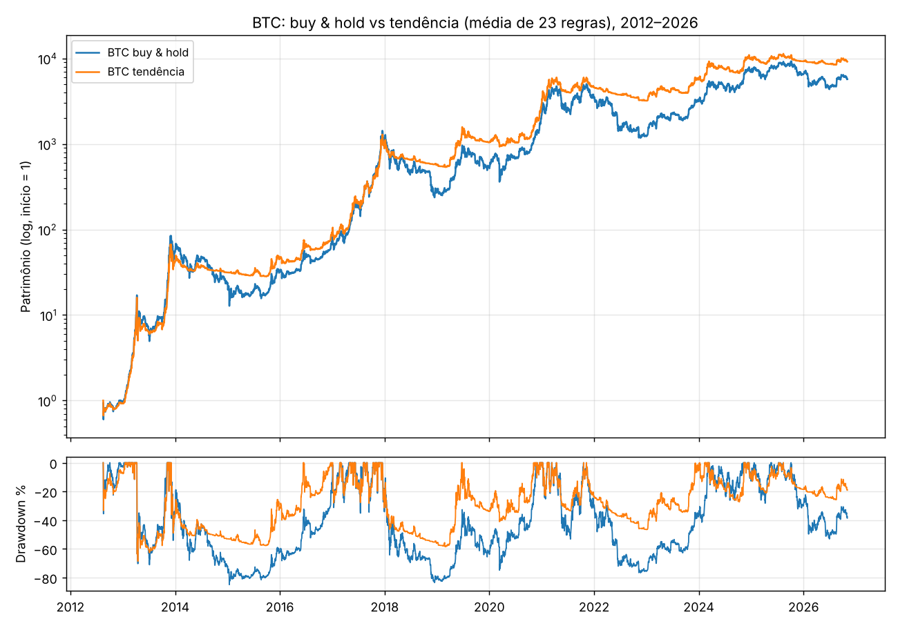
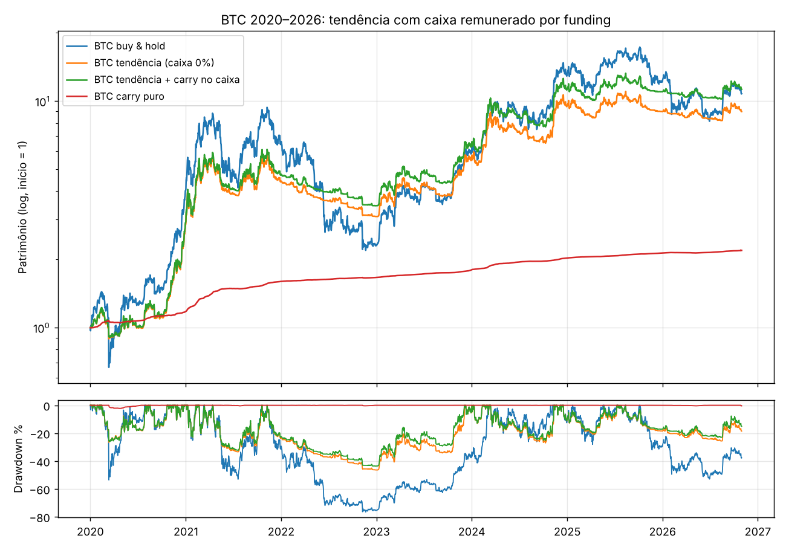
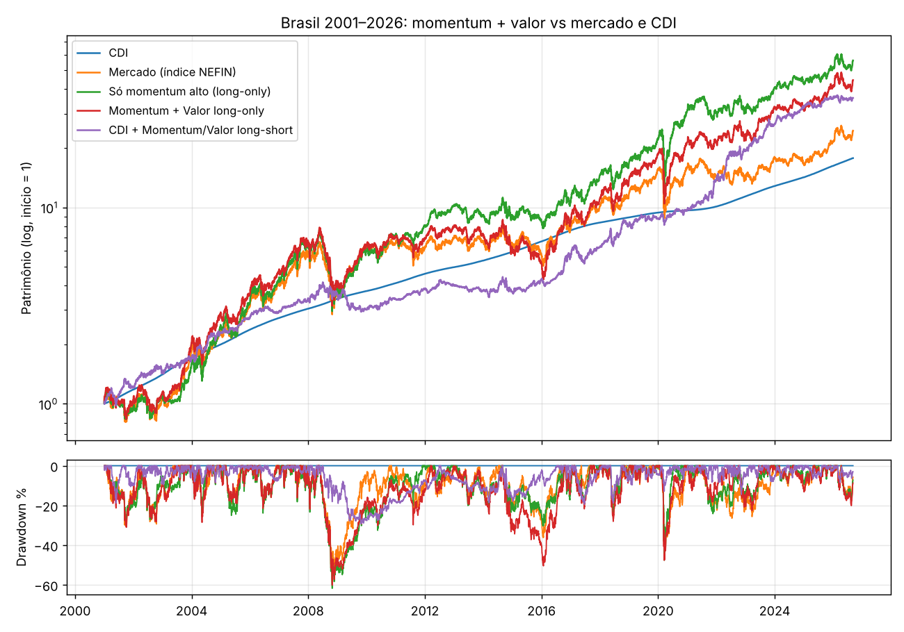

# Estudo: as 3 melhores estratégias de trading em ações e cripto

> Data: 03/11/2026. Todo o código está em [`research/`](../research) e é reprodutível.
> Tabelas completas: [`acoes.md`](../research/results/acoes.md), [`cripto.md`](../research/results/cripto.md), [`finalistas.md`](../research/results/finalistas.md).
>
> **Aviso:** este estudo é um backtest. Resultado passado não garante resultado futuro, e nada aqui é recomendação de investimento. Toda estratégia de trading pode perder dinheiro.

## 1. Conclusão

Testei cerca de **250 variantes** de estratégias de 6 famílias:
- **fundamentalista:** valor, qualidade, investimento, tamanho, valuation (CAPE) e beta/volatilidade;
- **técnica/gráfica:** médias móveis, rompimentos, momentum de série temporal, RSI, Bollinger e padrões de candle;
- **cross-section:** ranking entre ativos;
- **long/short:** fatores long-short, tendência com venda e carry de derivativos;
- **sazonalidade;**
- **reversão à média.**

Os dados cobrem **EUA 1926–2026, Brasil 2001–2026 e cripto 2011–2026**, incluindo moedas que já morreram.

| # | Estratégia | Família | Evidência principal |
|---|---|---|---|
| **1** | **Tendência em BTC/ETH:** média de 23 regras, comprado ou caixa | Técnica | BTC 2018–2026: **36%/ano com queda máxima de −46%**, contra 22%/ano e −81% do buy & hold. Sharpe 1,03 contra 0,63. Positiva nos 3 testes independentes, com 100% das regras positivas fora da amostra. |
| **2** | **Carry de funding:** compra spot e vende perpétuo (delta-neutro) | Long/short | Sharpe > 7, porque o retorno é quase sem oscilação. Rende pouco (≈ 5–7% a.a. em dólar de 2023 a 2026). **Usado como "caixa remunerado" da estratégia 1**, eleva o BTC de 32% para 36% a.a. em 2023–2026 e melhora o Sharpe de 1,07 para 1,17. |
| **3** | **Momentum em ações brasileiras:** compra as ações que mais subiram em 12 meses, com valor como complemento no long-short | Quantitativa/fundamentalista | Long-only: **17,3% a.a. contra 13,5% do mercado e 12,1% do CDI** (2001–2026), ganhando nas duas metades da amostra. Long-short momentum + valor com colateral em Tesouro Selic: **19,8% a.a. com queda máxima de −19,5%** em 2014–2026. |

**As estratégias 1 e 2 formam um único sistema 100% automatizável via API.** A estratégia 3 também é robusta, mas a B3 não tem API de execução gratuita para pessoa física. Por isso ela entra como sinal mensal, e a execução é feita por você (cerca de 10 minutos por mês).

## 2. Dados (todos encontrados no GitHub)

| Mercado | Repositório / fonte | Cobertura |
|---|---|---|
| Fatores EUA (Ken French): mercado, tamanho, valor, rentabilidade, investimento, momentum, reversões | [ZhenHaoFu810/StataFlow](https://github.com/ZhenHaoFu810/StataFlow), [chdejager/taming-the-factor-zoo-a-recreation](https://github.com/chdejager/taming-the-factor-zoo-a-recreation), [fernando-duarte/ERP](https://github.com/fernando-duarte/ERP) | 1926 → fev/2026 (diário até 2021) |
| Carteiras por beta e volatilidade (EUA) | [fernando-duarte/ERP](https://github.com/fernando-duarte/ERP) | 1963 → 2021 |
| S&P 500 com dividendos, lucros e CAPE (Shiller) | [datasets/s-and-p-500](https://github.com/datasets/s-and-p-500) | 1871 → 2026 |
| Fatores do mercado brasileiro (mercado, tamanho, valor, momentum, iliquidez) e taxa de aluguel de ações | [nefin/nefin.github.io](https://github.com/nefin/nefin.github.io) (NEFIN, FEA-USP) | 2001 → set/2026 |
| BTC diário | [rcaljouw/btc-price-history](https://github.com/rcaljouw/btc-price-history) | 2011 → nov/2026 |
| **701 pares USDT da Binance** (inclui deslistados, como a LUNA) + funding de **924 perpétuos** | [binance/binance-public-data](https://github.com/binance/binance-public-data) (arquivos em data.binance.vision) | 2017 → out/2026 |

Para baixar tudo de novo: `bash research/data/fetch_github_data.sh` e `python research/data/download_binance.py`.

## 3. Método (as regras que eu me impus para não me enganar)

1. **Sem olhar o futuro:** a decisão é tomada no fechamento de *t* e só rende a partir de *t+1*. O CAPE entra com 1 mês de atraso, porque o lucro é divulgado depois.
2. **Custos sempre incluídos:**
   - cripto spot: 0,15% por lado;
   - perpétuo: 0,08% por lado, mais o funding real pago ou recebido;
   - ETF: 0,05% a 0,10%;
   - fatores de ações: estimativa de giro, mais aluguel real de ações (NEFIN) no long-short.
3. **Teste fora da amostra (OOS):** escolho parâmetros só no período inicial e meço no período seguinte. Cripto: até 2022 contra 2023–2026. BTC longo: até 2019 contra 2020–2026. EUA: até 1989 contra 1990–2026.
4. **Sem viés de sobrevivência:** o universo de cripto é definido dia a dia pelas 20 ou 50 moedas de maior volume naquele momento, incluindo as que depois foram deslistadas ou zeraram.
5. **Sem viés de aquecimento:** regras de janela longa só são comparadas a partir do dia em que têm histórico suficiente. Encontrei e corrigi esse viés no meio do estudo.
6. **Correção por múltiplos testes:** reporto o *Sharpe deflacionado* (Bailey & López de Prado), que desconta a sorte de testar centenas de variantes.
7. **A estratégia 1 não tem parâmetro escolhido.** Ela é a média simples das 23 regras de tendência da grade, todas com o mesmo peso. Escolher "a melhor regra" no passado deu resultado **pior** fora da amostra (ver seção 5).

## 4. As 3 finalistas

### 4.1 Tendência em BTC/ETH (comprado ou caixa)

**Regra:** todo dia, às 00:00 UTC, calcula 23 sinais de tendência:
- preço acima das médias de 10 a 200 dias;
- 6 cruzamentos de médias;
- 3 rompimentos de Donchian;
- momentum de 7 a 365 dias.

A posição é a fração de sinais positivos. Por exemplo, 17 de 23 positivos significa 74% comprado e 26% em caixa.

**Por que funciona:** momentum de série temporal é um dos fenômenos mais documentados em finanças, com evidência em ações, juros, moedas e commodities desde o século XIX. Em cripto, ele é amplificado por fluxo de varejo e alavancagem que se retroalimentam. Nos meus próprios dados, a tendência aparece em 3 lugares diferentes:
- no BTC desde 2012;
- no mercado americano desde 1927 (a média de 10 meses corta a queda máxima de −84% para −43%);
- nos candles: o rompimento da máxima de 20 dias gera +1,1% em 5 dias fora da amostra (t = 5,5).

| Teste | Buy & hold | Tendência |
|---|---|---|
| BTC 2012–2026 (Bitstamp) | 84% a.a. · Sharpe 1,19 · DD −85% | **90% a.a. · Sharpe 1,47 · DD −69%** |
| BTC 2020–2026 | 41% a.a. · Sharpe 0,88 · DD −77% | **37% a.a. · Sharpe 1,05 · DD −47%** |
| BTC Binance 2018–2026 | 22% a.a. · Sharpe 0,63 · DD −81% | **36% a.a. · Sharpe 1,03 · DD −46%** |
| ETH Binance 2018–2026 | 29% a.a. · Sharpe 0,72 · DD −79% | **44% a.a. · Sharpe 0,97 · DD −47%** |
| 50/50 BTC+ETH 2018–2026 | 36% a.a. · Sharpe 0,79 · DD −76% | **44% a.a. · Sharpe 1,10 · DD −45%** |
| BTC com custos dobrados (2012–2026) | — | 86% a.a. · Sharpe 1,43, quase sem mudança |

**O preço a pagar:** em alta forte e contínua, a estratégia fica para trás. Em 2023 rendeu +77% enquanto o BTC fez +156%. Ela ganha nas quedas: em 2018 fez −9% contra −73%, e em 2022, −30% contra −64%. Em mercado de lado, como em 2025–2026, ela empata ou perde pouco.

**Sinal de alerta que também encontrei:** a mesma regra aplicada numa cesta de altcoins (top-20 por volume) **falhou fora da amostra**, com Sharpe de 0,06 em 2023–2026. O efeito é robusto em BTC e ETH, não em altcoins.

### 4.2 Carry de funding (long/short delta-neutro) como "caixa remunerado"

**Regra:** comprar BTC no spot e vender a mesma quantidade no contrato perpétuo. O preço deixa de importar. Quem está vendido no perpétuo **recebe o funding** a cada 8 horas, porque historicamente há mais comprados alavancados do que vendidos.

| Funding anual recebido | 2020 | 2021 | 2022 | 2023 | 2024 | 2025 | 2026 (até out) |
|---|---|---|---|---|---|---|---|
| BTC | 17% | 31% | 4% | 8% | 12% | 5% | 3% |
| ETH | 28% | 38% | 1% | 8% | 13% | 5% | 2% |

Sozinho, o carry rende pouco hoje. Com capital conservador (1,5× o tamanho da posição), foram ≈ 5% a.a. em dólar de 2023 a 2026, **abaixo do CDI**. A ideia vencedora é combinar com a estratégia 1:

**Tendência + carry no caixa:** ficar sempre 100% em BTC spot e, quando a tendência manda sair, vender perpétuo na fração correspondente. A posição fica neutra e passa a **receber funding em vez de ficar parada em USDT a 0%**. Bônus: as trocas acontecem no perpétuo, que tem taxa menor que o spot.

| BTC | 2020–2026 | 2023–2026 |
|---|---|---|
| Buy & hold | 41,6% a.a. · Sharpe 0,89 · DD −77% | 49,6% a.a. · Sharpe 1,10 · DD −53% |
| Tendência (caixa 0%) | 37,9% a.a. · Sharpe 1,06 · DD −47% | 32,1% a.a. · Sharpe 1,07 · DD −27% |
| **Tendência + carry** | **42,5% a.a. · Sharpe 1,16 · DD −44%** | **36,1% a.a. · Sharpe 1,17 · DD −25%** |

**Riscos que o backtest não captura:**
- quebra ou bloqueio da corretora, como a FTX em 2022;
- desalavancagem forçada (ADL) em dias extremos;
- mudança de regras de margem.

Isso exige corretora com margem unificada (o spot serve de garantia para o perpétuo) e chave de API sem permissão de saque.

**Variante que falhou:** caçar as 5 altcoins com maior funding do momento. Rendeu +12% a.a. até 2022 e **−5,8% a.a. de 2023 a 2026**, por causa de custos e inversões de funding.

### 4.3 Momentum em ações brasileiras (fundamentalista/quantitativa)

**Regra:** uma vez por mês, compra o terço das ações líquidas da B3 com maior retorno em 12 meses, desconsiderando o último mês. A versão long-short soma o fator valor (P/VPA baixo menos alto), que tem correlação negativa com momentum (−0,16) e por isso suaviza a carteira.

| Brasil (NEFIN) | 2001–2026 | 2001–2013 | 2014–2026 |
|---|---|---|---|
| CDI | 12,1% a.a. | 14,0% | 10,1% |
| Mercado | 13,5% a.a. · Sharpe 0,17 · DD −57% | 16,2% · 0,20 | 10,9% · 0,14 |
| **Momentum long-only** | **17,3% a.a. · Sharpe 0,31 · DD −62%** | **18,9% · 0,29** | **15,6% · 0,32** |
| CDI + long-short momentum/valor | 15,2% a.a. · Sharpe 0,27 · DD −29% | 10,9% · −0,16 | **19,8% · 0,66 · DD −19,5%** |

**Por que momentum no Brasil e não nos EUA:** nos EUA, quase todos os fatores clássicos **perderam força depois de publicados** (dados de 2010 a 2025):
- valor: Sharpe −0,07;
- tamanho: −0,11;
- reversão de longo prazo: −0,17;
- investimento: 0,06;
- reversão de curto prazo: 0,05;
- momentum: 0,22 (enfraquecido);
- qualidade/rentabilidade: 0,40, o único que se manteve.

No Brasil, momentum se manteve, com Sharpe de 0,34 em 2001–2013 e 0,67 em 2014–2026.

**Limitação:** a versão long-only cai junto com a bolsa (−62% em 2008). A long-short perdeu para o CDI em 2001–2013. É a mais fraca das três, mas é a melhor opção em ações.

## 5. O que NÃO funcionou (e é útil saber)

| Estratégia | Resultado |
|---|---|
| **Escolher a "melhor regra" de tendência no passado** | A melhor regra de cada teste no período inicial teve desempenho **pior** fora da amostra que a média das regras. Exemplo: Donchian 100/50 no BTC teve Sharpe 1,33 no período inicial e 0,44 depois. Otimizar parâmetro é a forma mais comum de se enganar. |
| **Tendência long/short** (vender na tendência de baixa) | Pior que ficar em caixa em BTC, ETH e ações. As vendas perdem com a alta estrutural, e o BTC chegou a Sharpe −0,46 fora da amostra. |
| **Momentum entre altcoins** (comprar as que mais subiram) | Funcionou até 2022 e **colapsou** depois: Sharpe negativo em 17 de 20 variantes de 2023 a 2026. A carteira top-5 perdeu −77% a.a., porque as altcoins que disparam devolvem a alta logo em seguida (−2,0% por semana). |
| **Reversão à média** (RSI(2), Bollinger, comprar após quedas) | Só funcionou no BTC em 2023–2026, que foi um mercado de alta. Falhou em 2018–2022 e no ETH. A versão vendida em sobrecompra perdeu −27% a.a. Nas ações americanas, o RSI(2) foi negativo antes de 1990. |
| **Padrões de candle** (engolfo, martelo, doji, três soldados) | Nenhum tem vantagem depois de custos fora da amostra. O engolfo de alta inverteu de sinal. A exceção é o **rompimento de máxima**, que é tendência. |
| **Valuation (CAPE) para entrar e sair da bolsa** | Ficou fora do mercado na maior parte desde 1990: 3,9–5,7% a.a. contra 10,8% do buy & hold. |
| **Fatores clássicos nos EUA após publicação** | Valor, tamanho, investimento e reversões ficaram próximos de zero de 2010 a 2025 (ver 4.3). |
| **Timing da bolsa brasileira** (média de 200 dias ou momentum contra o CDI) | Não supera o CDI em 2014–2026 (Sharpe de 0,04 e −0,03). Com juros altos, ficar fora da bolsa já paga bem. |
| **Sazonalidade** ("sell in May", dia da semana no BTC, virada de mês) | Efeitos fracos (t < 2,1 em centenas de testes) ou que sumiram depois de publicados. A virada de mês caiu de Sharpe 0,88 antes de 1990 para 0,37 depois. |

## 6. Limitações honestas

- **Capital:** o custo de infraestrutura é zero, mas **as estratégias precisam do seu capital** e podem perder parte dele. A queda máxima histórica da estratégia 1 foi de −46% a −69%, conforme o período.
- **Os últimos 2 anos foram fracos:** em 2025–2026 a tendência em BTC ficou perto de zero, com −5% e 0%. Regimes mudam.
- **O carry está encolhendo:** o funding médio caiu à medida que o mercado ficou mais profissional (fundos de base, Ethena).
- **Dados de ações brasileiras:** são carteiras teóricas do NEFIN. Não incluem impacto de mercado em ações pequenas.
- **Impostos:** ganhos com cripto e ações são tributáveis no Brasil, e as regras mudaram recentemente. Valide com um contador antes de operar.

## 7. Restrições de implementação já identificadas (detalhe no Passo 2)

1. **A Binance bloqueia acessos dos EUA:** daqui ela respondeu HTTP 451. Os runners gratuitos do GitHub Actions rodam em datacenters nos EUA, então precisaremos de uma corretora que atenda residentes no Brasil e aceite chamadas de API desses servidores, ou de um runner próprio. Isso afeta principalmente o perpétuo (estratégia 2).
2. **B3 sem API gratuita de execução:** a estratégia 3 roda como sinal mensal enviado a você.
3. **Regra de uso do Actions:** o uso esperado é ligado ao próprio software do repositório. Um job diário de cerca de 1 minuto tem impacto mínimo, mas é uma zona cinzenta que registro aqui.
