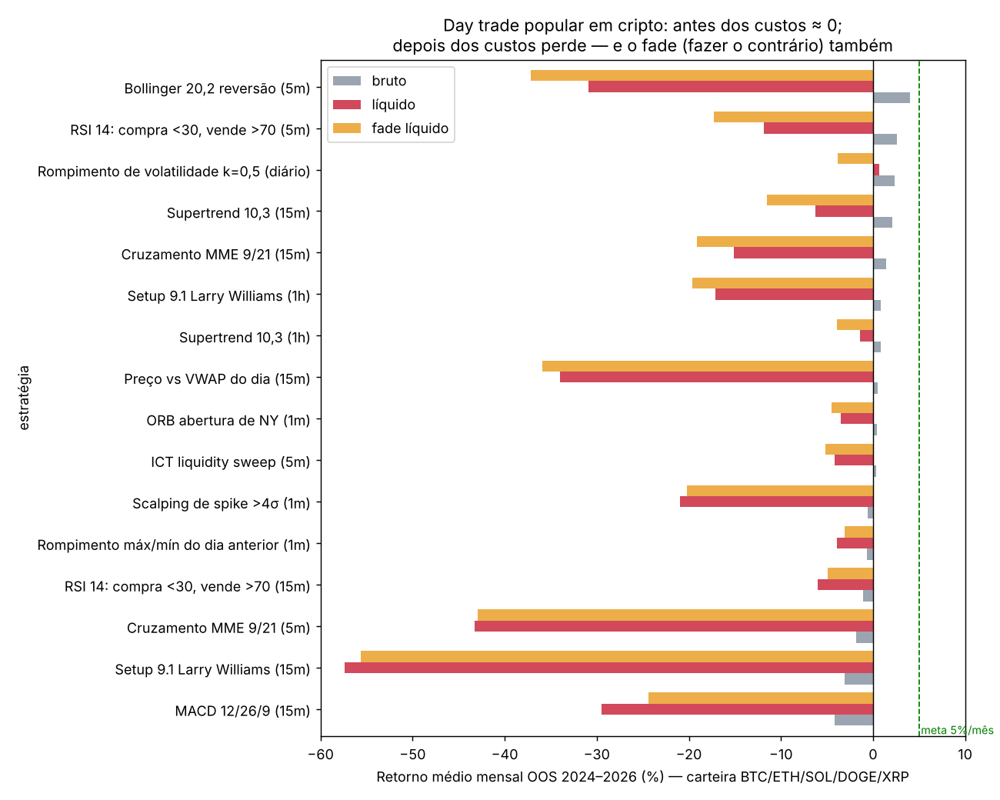
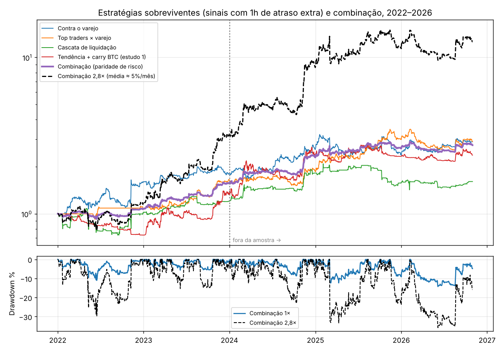

# Estudo 2: day trade com dados de 1 minuto, "ir contra" o varejo e a meta de 5% ao mês

> Data: 03/11/2026. Código em [`research/intraday/`](../research/intraday); tabelas completas em [`research/results/intraday_*.md`](../research/results).
> **Aviso:** backtests não garantem resultado futuro e nada aqui é recomendação de investimento. Alavancagem pode levar à perda total do capital.

## Resposta curta

1. **Nenhuma estratégia testada rende 5% ao mês de forma consistente sem alavancagem.** As que mostraram isso no passado caíram muito fora da amostra:
   - rompimento de volatilidade: 6,8%/mês em 2020–2023, apenas 0,7%/mês em 2024–2026;
   - contra o varejo: 6,9%/mês, depois 2,3%/mês.
2. **As 15 estratégias de day trade mais populares perdem dinheiro depois dos custos, e fazer o contrário delas (o "fade") também perde.** Antes dos custos, elas rendem perto de zero. O day trader perde **pelo custo** (taxa + spread a cada operação), não por errar a direção. Por isso não dá para lucrar só invertendo o setup gráfico.
3. **Dá para ir contra o varejo usando o posicionamento real dele.** Usei os dados da Binance que dizem quantas contas estão compradas e vendidas. Vender quando o varejo está anormalmente comprado, e comprar no inverso, rendeu **+1,7% a +2,7% ao mês fora da amostra**. O resultado foi positivo nos 5 ativos e em **54 de 54 variantes** testadas.
4. **Combinando 4 sinais pouco correlacionados**, o resultado sem alavancagem foi **+1,8% ao mês fora da amostra** (Sharpe 1,31, queda máxima −14%). **Com 2,8× de alavancagem, a média vira 5,3% ao mês** (2022–2026). Porém:
   - só 45% dos meses passaram de 5%;
   - o ano mediano simulado rende +63%;
   - há 14% de chance de terminar o ano no prejuízo;
   - **desde mar/2025 a estratégia andou de lado** (+2,7% em 20 meses a 2,8×).
5. **Machine learning (LightGBM) não superou as regras simples.** Mas confirmou que a informação mais valiosa é o posicionamento do varejo e dos grandes traders.

## 1. Dados

| Dado | Fonte | Tamanho |
|---|---|---|
| Candles de **1 minuto** dos perpétuos BTC, ETH, SOL, DOGE e XRP, com volume agressor | [binance/binance-public-data](https://github.com/binance/binance-public-data) | 17,3 milhões de candles (2020 → out/2026) |
| Posicionamento de 5 em 5 min: razão long/short das **contas** (varejo) e das **posições dos top traders**, open interest, fluxo agressor | idem (`futures/um/daily/metrics`) | 2,7 milhões de registros (2020/21 → out/2026) |
| Funding a cada 8h | idem | 924 perpétuos |
| **SPY 1 minuto** (pré, regular e pós-mercado) | [CryonicArtist/Xlchedelic](https://github.com/CryonicArtist/Xlchedelic) | 2,07 milhões de candles (2008 → 2021) |
| **Mini-índice WIN 5 min** (exportado do ProfitPro) | [Bielhpp/MarketPrediction_WinfutBr-CandlestickChart](https://github.com/Bielhpp/MarketPrediction_WinfutBr-CandlestickChart) | 90 pregões (jun → out/2023) |

**Custos usados por lado:**
- cripto: 0,05% de taxa agressora + 0,01–0,02% de slippage, mais o funding real;
- SPY: 1 pb (conservador) ou 0,25 pb (otimista);
- WIN: 0,005% (1 tick + emolumentos).

**Divisão da amostra:**
- cripto: 2020–2023 dentro da amostra (IS) e 2024–out/2026 fora da amostra (OOS);
- SPY: 2008–2015 (IS) e 2016–2021 (OOS).

## 2. O que os day traders usam, e quanto perdem

Fóruns e blogs de corretoras citam com mais frequência: **VWAP, rompimento da faixa de abertura (ORB), cruzamento de médias (MME 9/21), RSI 30/70, Bollinger, Supertrend, MACD**. Nos últimos anos também ganharam espaço os conceitos "ICT" (*liquidity sweep*). No Brasil, os mais citados são o **setup 9.1 de Larry Williams e o PFR**. Entre os bots open-source do GitHub, os mais populares são os do Freqtrade, como o NostalgiaForInfinity, que majoritariamente compram quedas em 5 minutos. Não existe pesquisa rigorosa que ranqueie esses setups; testei todos os citados acima.

**Evidência sobre os resultados reais:**
- O estudo da CVM com a FGV (Chague, De-Losso e Giovannetti) acompanhou quem começou a operar mini-índice entre 2013 e 2015. Entre os que persistiram, **só 3% (47 de 1.551) tiveram lucro** líquido de custos.
- O artigo mais citado a favor do day trade (Zarattini e Aziz, ORB em QQQ, "33% de alfa ao ano") teve uma replicação independente em 5 índices que reproduziu o resultado bruto, mas **zero líquido de custos**.

## 3. Resultado 1: os setups populares e o "fade" (cripto, 1 minuto)

Carteira igual entre os 5 ativos, retorno médio mensal fora da amostra (2024–2026):

| Estratégia | Antes dos custos | Depois dos custos | **Fade** (o contrário), depois dos custos |
|---|---|---|---|
| Bollinger 20,2 reversão (5m) | **+4,0%** | −30,9% | −37,2% |
| RSI 14 30/70 (5m) | +2,6% | −11,9% | −17,3% |
| Rompimento de volatilidade k=0,5 (diário) | +2,3% | +0,7% | −3,8% |
| Supertrend 10,3 (15m / 1h) | +2,1% / +0,8% | −6,3% / −1,4% | −11,5% / −3,9% |
| Cruzamento MME 9/21 (5m / 15m) | −1,8% / +1,4% | −43,3% / −15,1% | −42,9% / −19,1% |
| Setup 9.1 Larry Williams (15m / 1h) | −3,1% / +0,8% | −57,4% / −17,1% | −55,6% / −19,6% |
| MACD 12/26/9 (15m) | −4,2% | −29,5% | −24,4% |
| Preço vs VWAP do dia (15m) | +0,5% | −34,0% | −35,9% |
| ORB abertura de Nova York (1m) | +0,4% | −3,5% | −4,5% |
| Rompimento máx/mín do dia anterior (1m) | −0,7% | −3,9% | −3,1% |
| ICT *liquidity sweep* (5m) | +0,3% | −4,2% | −5,2% |
| Scalping de candle de 1 min > 4σ | −0,6% | −21,0% | −20,2% |

**Por que o fade não funciona:** um round-trip custa ≈ 0,12–0,14%. Os setups operam de algumas vezes a dezenas de vezes por dia, e a vantagem bruta deles fica perto de zero. Inverter o sinal inverte uma vantagem que é quase nula e **paga o mesmo custo**. O dinheiro que o day trader perde vai para a corretora (taxas) e para os formadores de mercado (spread), não para quem aposta contra ele.

### E se eu for o formador de mercado? (ordens limitadas)

O único efeito bruto relevante é a reversão em 5 minutos (Bollinger, +4% ao mês bruto). Por isso simulei capturá-lo do jeito de um formador de mercado: **ordens limitadas paradas nas bandas**, com taxa de maker e execução só se o preço atravessar o nível.
- **Comprando a mercado depois que o candle fecha fora da banda:** vantagem bruta de **+0,014% por operação**, contra 0,12% de custo.
- **Com ordem limitada na banda e taxa zero:** **−0,03% por operação**. A ordem só é executada quando o preço atravessa a banda e continua andando contra ela (*seleção adversa*).

**Conclusão:** essa vantagem só existe para quem tem infraestrutura de alta frequência (latência e prioridade na fila), o que está fora do alcance de um sistema em GitHub Actions.

## 4. Resultado 2: ir contra o varejo pelo **posicionamento real**

**O que o varejo faz (dados Binance):**
- **59% a 75% das contas ficam compradas** na média, dependendo do ativo.
- A variação da razão long/short em 24h tem **correlação de −0,34 a −0,57 com o retorno do mesmo período**: o varejo compra quando cai e vende quando sobe.

Resultados das estratégias que seguram a posição por 24h (custos e funding incluídos, carteira dos 5 ativos):

| Sinal | 2020–2023 (IS) | 2024–2026 (OOS) | Seguir o sinal ao contrário (OOS) |
|---|---|---|---|
| **Contra o varejo**: contas muito compradas (z > 2) → vende; muito vendidas → compra | +6,9%/mês · Sharpe 2,00 | **+2,3%/mês · Sharpe 0,94** · DD −25% | −4,0%/mês |
| **Top traders compram enquanto o varejo vende** (e vice-versa) | +2,7%/mês · Sharpe 1,05 | **+2,4%/mês · Sharpe 1,09** · DD −27% | −4,0%/mês |
| **Cascata de liquidação** (queda forte + open interest despenca) → compra | +2,8%/mês · Sharpe 0,97 | **+1,5%/mês · Sharpe 0,77** | −2,4%/mês |
| Seguir os top traders sozinhos | +0,1%/mês | +0,2%/mês | — |
| Contra o fluxo agressor extremo | −2,2%/mês | −2,0%/mês | — |
| Contra o funding extremo | +1,9%/mês | −0,8%/mês | — |

**Robustez:**
- **54 de 54 variantes** positivas fora da amostra. A grade combinou 3 atrasos extras (0, 1 e 2h, para eliminar qualquer dúvida sobre o horário de publicação das métricas), 3 limiares e 3 prazos de manutenção.
- Positivo **nos 5 ativos** individualmente.
- **Limitação crítica:** com 25h de atraso o sinal se degrada (Sharpe IS negativo e "top traders × varejo" vai a zero). O sistema precisa dos dados **em tempo quase real** pela API da Binance (ver seção 8).

## 5. Resultado 3: day trade em ações

### SPY, 1 minuto (2008–2021)

| Estratégia (artigo de origem) | IS 2008–2015 | OOS 2016–2021 |
|---|---|---|
| ORB 5 min, 1% de risco/trade até 4× (Zarattini & Aziz 2023), custo 0,25 pb | +12,7%/ano | **−5,1%/ano** |
| ORB 5 min, 1% de risco/trade até 4×, custo 1 pb (varejo) | −2,1%/ano | −17,8%/ano |
| "Zona de ruído" com vol-alvo até 4× (Zarattini, Aziz & Barbon 2024), custo 0,25 pb | +11,8%/ano · Sharpe 0,85 | **+10,2%/ano · Sharpe 0,70** |
| "Zona de ruído", custo 1 pb | +3,2%/ano | +0,5%/ano |
| Momentum 1ª → última meia hora (Gao et al. 2018) | +1,8%/ano | −4,9%/ano |
| Fade de gap > 0,3% | +3,5%/ano | −0,7%/ano |
| MME 9/21, RSI 30/70, VWAP (5m) e seus fades | todos negativos | todos negativos |
| Buy & hold SPY | +5,7%/ano | +14,5%/ano |

O ORB, estratégia queridinha do YouTube, **não se generaliza do QQQ para o SPY** e perdeu dinheiro de 2016 a 2021. A "zona de ruído" sobrevive, mas só com custo institucional, e rende ≈ 1% ao mês com 4× de alavancagem.

### Mini-índice WIN, 5 min (90 pregões em 2023; amostra curta, apenas ilustrativa)

| Setup | Bruto | Líquido | Fade líquido |
|---|---|---|---|
| 9.1 (MME9) | −4,4%/mês | −8,1%/mês | +0,5%/mês |
| PFR | −2,0%/mês | −4,1%/mês | −0,1%/mês |
| ORB do 1º candle | +1,8%/mês | +1,6%/mês | −2,0%/mês |
| Preço vs VWAP | −3,1%/mês | −4,7%/mês | +1,4%/mês |

No WIN o custo relativo é baixo (0,005%), por isso fazer o contrário do 9.1 e do VWAP chega a ficar levemente positivo. Com 4 meses de dados, nada disso é estatisticamente significativo.

## 6. Resultado 4: machine learning (LightGBM, walk-forward mensal)

O modelo usou 25 variáveis: preço, volatilidade, posicionamento, fluxo agressor, open interest, funding e calendário. Foram 193 mil previsões horárias, todas fora da amostra (jun/2022–out/2026).
- **Correlação média entre previsão e retorno (IC): 0,029**, positiva em 62% dos meses.
- **Resultado operado:** Sharpe de 0,36 a 0,52 e +0,6 a +1,2% ao mês em 2024–2026. Ficou **abaixo das regras simples** da seção 4.
- **Variáveis mais importantes:** posicionamento do varejo no BTC (11%), volatilidade, nível dos top traders e nível do varejo. **O ML confirma que a informação útil é o posicionamento.**

## 7. A meta de 5% ao mês

Juntei os 4 sinais sobreviventes (com 1h de atraso extra) com pesos de risco iguais, estimados só em 2022–2023:
- contra o varejo;
- top traders × varejo;
- cascata de liquidação;
- tendência + carry do estudo 1.

As correlações entre eles vão de −0,11 a 0,46.

| | Sem alavancagem | Com 2,8× |
|---|---|---|
| 2022 | +8% | +17% |
| 2023 | +46% | +172% |
| 2024 | +46% | +170% |
| 2025 | +15% | +35% |
| 2026 (até out) | +4% | +8% |
| Média mensal 2022–2026 | +1,9% | **+5,3%** (mediana 3,1%) |
| Meses ≥ 5% | 16% | 45% |
| Pior mês | −5,5% | −14,9% |
| Queda máxima | −14% | −36% |
| Desde mar/2025 | +5% | +2,7% |

**Monte Carlo** (10.000 anos simulados por bootstrap dos retornos de 2024–2026):

| Alavancagem | Ano mediano | P(bater 5%/mês ≈ +80%/ano) | P(queda ≥ 50% no caminho) | P(terminar no prejuízo) |
|---|---|---|---|---|
| 1× | +22% | 2% | 0% | 11% |
| 2× | +43% | 27% | 0% | 14% |
| **2,8×** | **+63%** | **42%** | **4%** | **14%** |
| 5× | +102% | 56% | 43% | 20% |

**Leitura honesta:**
- 5% ao mês **na média** é tecnicamente alcançável com ~3× de alavancagem sobre uma carteira diversificada desses sinais.
- Mesmo assim, em mais da metade dos anos simulados a meta não é atingida.
- A vantagem enfraqueceu desde 2025.
- O tamanho da alavancagem foi calibrado com os próprios dados de 2024–2026, o que deixa o resultado otimista.
- Acima de ~3×, o risco de cair 50% cresce rápido (43% a 5×).

## 8. Implicações para o sistema

1. **O sinal novo depende de dados da Binance em tempo quase real.** A API da Binance bloqueia acessos dos EUA (HTTP 451), onde rodam os runners gratuitos do GitHub. Os arquivos públicos diários chegam tarde demais (com 25h de atraso o sinal não funciona). A solução de custo zero seria um **runner próprio do GitHub Actions no Brasil**, por exemplo numa VM "Always Free" da Oracle Cloud na região de São Paulo, ou no seu próprio computador.
2. A execução também precisa de uma corretora de perpétuos acessível a partir desse runner, com chave de API sem permissão de saque.
3. Recomendo começar **sem alavancagem (1×) em modo simulado**. Só depois de 2 a 3 meses de resultado real compatível com o backtest valeria considerar 2×. Acima de 3×, os números mostram que o risco cresce muito mais rápido que o retorno.

## Fontes externas citadas

- Chague, De-Losso & Giovannetti, *Day Trading for a Living?* (dados CVM): [Scribd/SSRN](https://www.scribd.com/document/428540384/SSRN-id3423101), [Seu Dinheiro](https://www.seudinheiro.com/e-possivel-viver-ou-morrer-de-day-trade-na-bolsa/), [FGV EESP 2025](https://portal.fgv.br/sites/default/files/uploads/eesp-pesquisa-day-trade-e-pandemia.pdf)
- Zarattini & Aziz, *Can Day Trading Really Be Profitable?*: [SSRN](https://papers.ssrn.com/abstract=4416622); replicação líquida zero: [MQL5](https://www.mql5.com/en/blogs/post/776235)
- Popularidade de VWAP/breakouts: [Fortunly](https://fortunly.com/articles/day-trading-strategies), [NexusFi](https://nexusfi.com/showthread.php?p=817306), [Awake Trader (VWAP no WIN)](https://www.awaketrader.com/pt/educacao/vwap-mini-indice-2026-estrategia-institucional)
- Bots populares no GitHub: [freqtrade/freqtrade-strategies](https://github.com/freqtrade/freqtrade-strategies), [iterativv/NostalgiaForInfinity](https://github.com/iterativv/NostalgiaForInfinity)
