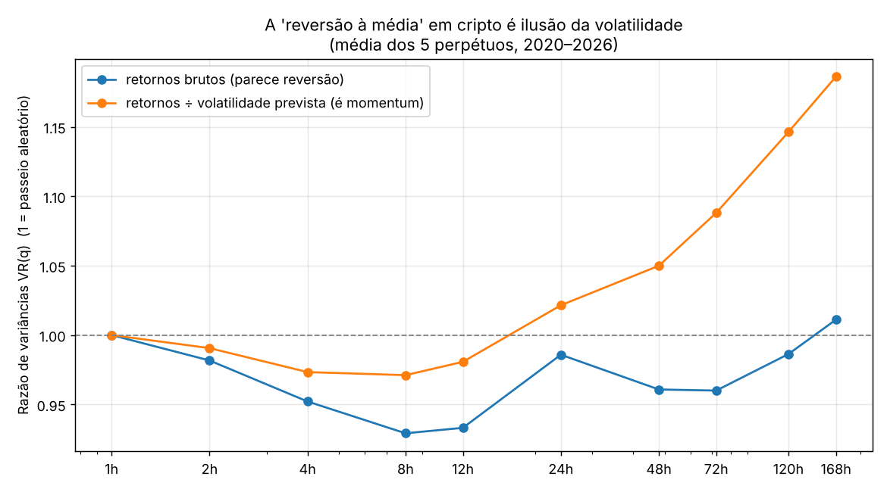
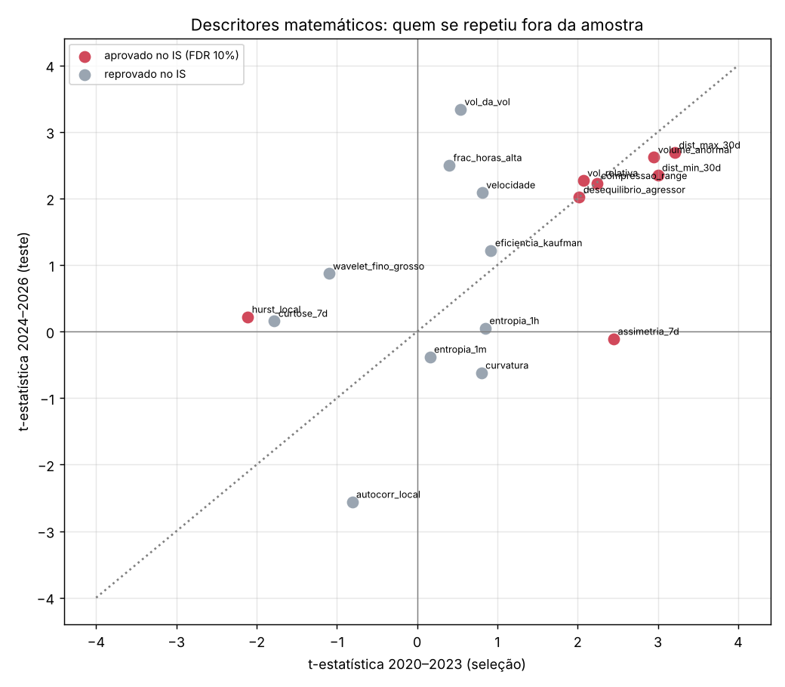

# Estudo 3: o gráfico como equação — procurando o que ninguém vê

> Data: 03/11/2026. Código em [`research/matematica/`](../research/matematica); tabelas em [`research/results/mat_*.md`](../research/results).
> **Aviso:** backtests não garantem resultado futuro; nada aqui é recomendação de investimento.

## Resposta curta

Tratei o preço como objeto matemático, sem nenhum indicador de prateleira. Usei os mesmos dados de 1 minuto (BTC, ETH, SOL, DOGE e XRP, 2020–2026) e a mesma regra de honestidade dos estudos anteriores: **descobrir só com dados até 2023 e testar em 2024–2026 sem mexer em nada.**

1. **O preço tem uma estrutura simples, e quase toda ela está na volatilidade, não na direção.**
   - **Ciclos:** Fourier não acha nenhum nos retornos. Na volatilidade, os ciclos de 24h, 8h (funding), 3,5 dias e 7 dias são **14× mais fortes que o acaso**.
   - **Previsibilidade:** o modelo HAR prevê a volatilidade de amanhã com **R² de 35% a 49%** fora da amostra.
2. **A "reversão à média" que aparece em cripto é ilusão.** Ela some quando os retornos são divididos pela volatilidade do momento, e por baixo aparece **momentum de 1 a 7 dias**. A "equação de memória" ajustada até 2023 rendeu 74% ao ano no período em que foi ajustada e **−10% ao ano depois**.
3. **Os "momentos ocultos" existem, mas são pequenos demais para a taxa de quem não é HFT:**
   - BTC liderando as altcoins por segundos: +0,02% a +0,08%, contra 0,12% de custo;
   - números redondos e o horário do funding: efeitos de 0,005% a 0,09%.
   - Ímãs de liquidação, arbitragem estatística por PCA/Ornstein-Uhlenbeck e pares com Kalman **não funcionaram**.
4. **A descoberta real é uma "equação de atenção e fluxo".** Entre 18 descritores matemáticos, 8 passaram no controle de falsas descobertas com dados até 2023, e **6 se repetiram em 2024–2026** com a mesma força:
   - proximidade da máxima/mínima de 30 dias;
   - volume anormal;
   - fluxo agressor comprador;
   - expansão de range;
   - volatilidade relativa.

   Perto da máxima do mês, com volume e agressão compradora fora do normal, o preço tende a continuar. Como estratégia, rendeu **+1,5% ao mês fora da amostra** (Sharpe 0,61).
5. **Ao juntar tudo, a fronteira não mudou.** A melhor carteira robusta segue rendendo **≈ 1,7–1,9% ao mês sem alavancagem** (Sharpe ≈ 1,3 fora da amostra). **5% ao mês só aparece com ~3× de alavancagem**, e isso traz cerca de 40% de chance de bater a meta num ano e 10–12% de chance de cair 50% no caminho.

## 1. A estrutura matemática do preço

### Onde existe memória (razão de variâncias de 2 minutos a 14 dias)

- **Retornos brutos:** VR < 1 entre 15 minutos e 3 dias em todos os ativos e nos dois períodos (0,75–0,90 entre 4h e 3 dias). Parece reversão à média.
- **Retornos divididos pela volatilidade prevista:** a reversão some. No BTC e no ETH aparece **momentum** a partir de 24h (VR 1,06 em 24h, 1,13 em 72h e 1,25 em 7 dias, todos fora do intervalo do acaso). Nas altcoins sobra uma reversão mínima de 4 a 12h (0,95–0,97) e momentum em 7 dias (1,14–1,16).
- **Interpretação:** os grandes crashes são seguidos de dias de volatilidade alta com recuperação parcial. Isso cria a aparência de reversão nas contas feitas com retornos brutos. Em unidades de risco, o preço tem leve memória **de tendência**, e é por isso que as estratégias de tendência do estudo 1 funcionam e as de reversão não.

### Ciclos (Fourier, períodos de 2h a 30 dias, limiar por permutação)

| Série | Ciclos significativos |
|---|---|
| Retornos (direção) | **nenhum**, em nenhum dos 5 ativos (maior pico = 0,77–0,95 do limiar do acaso) |
| Volatilidade | **24h, 8h (funding), 84h (½ semana), 168h (semana)**: 13,8× (BTC) e 14,4× (ETH) acima do limiar |

**Quem opera "ciclos" de preço está vendo padrões no ruído.** Os ciclos reais são da volatilidade.

### A volatilidade tem memória longa e é previsível

- Autocorrelação de |retorno|: 0,28–0,41 com 1h de defasagem e ainda 0,07–0,09 com 30 dias. A autocorrelação do retorno em si é praticamente zero (−0,006 a −0,028).
- **Modelo HAR** (componentes diária, semanal e mensal), ajustado até 2023: **R² fora da amostra de 0,34 a 0,49**. O erro fica 20% a 27% menor que o de "amanhã = hoje".

## 2. A equação de memória da direção (regressão de 6 termos, ajustada só em 2020–2023)

O único termo significativo foi o retorno padronizado das últimas 25 a 72h, com **coeficiente positivo** (t = 5,2): momentum de 1 a 3 dias.

| | 2020–2023 (ajuste) | 2024–2026 (teste) |
|---|---|---|
| Equação de memória | +74% ao ano, Sharpe 1,32 | **−9,9% ao ano** |
| Vender a alta de 24h | −21% ao ano | −25% ao ano |
| Vender a alta de 72h | −37% ao ano | −15% ao ano |

**Lição:** uma equação linear que explica perfeitamente o passado não sobreviveu. A memória da direção é fraca e muda de regime.

## 3. Momentos ocultos

| Ideia | O que se mediu fora da amostra | Veredito |
|---|---|---|
| **BTC lidera as altcoins** (BTC salta > 3σ no minuto e a altcoin fica para trás) | Altcoin segue o BTC: +0,016% a +0,083% em 1–15 min (t até 2,8) | **Real, mas menor que o custo** (0,12–0,14%). Território de alta frequência. |
| **Fluxo forçado no pagamento do funding** (funding no 20% mais alto) | −0,09% a +0,01% em torno do horário, sem padrão consistente entre ativos | Não há |
| **Números redondos** (BTC a cada 1.000, ETH 100...) vs níveis de controle | Continuação de −0,003% a −0,005%, igual ao controle | Não há |
| **Ímãs de liquidação** (mapa reconstruído do open interest com alavancagens de 5× a 100×) | Antes de 2024: −2,1%/mês (Sharpe −0,89); depois: +0,4%/mês (0,20) | Não há |
| **Arbitragem estatística PCA + Ornstein-Uhlenbeck** (Avellaneda & Lee) | −0,2% a −0,9%/mês nos dois períodos e em 3 configurações | Não funciona: os resíduos não revertem |
| **Pares com filtro de Kalman** (ETH/BTC, SOL/ETH, XRP/DOGE) | Em torno de zero ([mat_kalman.md](../research/results/mat_kalman.md)) | Não funciona |
| **Vender volatilidade** (DVOL × realizada, jul/2025–fev/2026) | Implícita 43,1% vs realizada 45,6%: prêmio **−2,5 pontos**; vendido em variância −0,35% a cada 30 dias | Sem prêmio no período (amostra curta) |

## 4. Mineração de equações com controle de falsas descobertas

Calculei 18 descritores matemáticos de hora em hora:
- entropia de permutação (1 minuto e 1 hora);
- Hurst local;
- velocidade e curvatura (ajuste polinomial);
- razão de energia de wavelets de Haar;
- assimetria, curtose, compressão de range e eficiência de Kaufman;
- autocorrelação local e distância da máxima/mínima de 30 dias;
- vol da vol, fração de horas de alta, volume anormal, fluxo agressor e volatilidade relativa.

A seleção usou só 2020–2023, com Benjamini-Hochberg a 10%.

- **Aprovados que se repetiram em 2024–2026 (t > 2, mesmo sinal):** distância da máxima de 30 dias (t 3,2 → 2,7), distância da mínima de 30 dias (3,0 → 2,4), volume anormal (3,0 → 2,6), compressão de range (2,2 → 2,2), desequilíbrio do fluxo agressor (2,0 → 2,0) e volatilidade relativa (2,1 → 2,3).
- **Aprovados que falharam:** Hurst local e assimetria.
- **Reprovados já no período de seleção:** entropia, curvatura, wavelets, curtose e eficiência. Os descritores "exóticos" não carregam informação sobre a direção.
- **Estratégia com o sinal composto** (definido em 2023, sem ajuste posterior): **+6,2%/mês em 2020–2023 → +1,5%/mês em 2024–2026** (Sharpe 1,96 → 0,61).

## 5. Gestão por volatilidade e a carteira final

A exposição foi ajustada todo dia por *alvo ÷ volatilidade prevista* (Moreira & Muir 2017):

| Estratégia (OOS 2024–2026) | Sem gestão | Com gestão de volatilidade |
|---|---|---|
| Contra o varejo | 1,7%/mês · Sharpe 0,75 · DD −29% | **2,0%/mês · Sharpe 1,05 · DD −19%** |
| Top traders × varejo | 1,9% · 0,88 | 1,7% · 0,92 |
| Cascata de liquidação | 1,0% · 0,56 | 1,2% · 0,58 |
| Tendência + carry BTC | 2,2% · 0,84 | 1,6% · 0,86 |
| Equação de atenção e fluxo (mineração) | 1,5% · 0,61 | 1,0% · 0,48 |
| **Carteira dos 5 (paridade de risco definida em 2023)** | **1,7% · 1,26 · DD −17%** | 1,6% · 1,07 · DD −22% |

- A gestão por volatilidade melhora claramente o "contra o varejo", mas **não melhora a carteira**, que já é diversificada.
- Incluir a equação de atenção e fluxo **não elevou** o Sharpe fora da amostra: a carteira de 4 do estudo 2 tinha 1,31.

**A meta de 5% ao mês** (Monte Carlo com 10.000 anos, a partir dos retornos de 2024–2026 da carteira de 5 com gestão de volatilidade):

| Alavancagem | Ano mediano | P(bater 5%/mês) | P(queda ≥ 50%) | P(ano no prejuízo) |
|---|---|---|---|---|
| 1× | +18% | 2% | 0% | 18% |
| 2× | +34% | 23% | 1% | 21% |
| 3× | +51% | 38% | 10% | 22% |
| 3,2× | +54% | 40% | 12% | 22% |

## 6. Conclusão

- **Sobre "é completamente possível":** existem traders e fundos que fazem mais de 5% ao mês em certos períodos. Nos dados, isso aparece com alavancagem alta, infraestrutura de alta frequência (latência e taxas de formador de mercado), informação privilegiada ou **sorte com viés de sobrevivência** (vemos quem ganhou, não os 97% que perderam).
- **Para um sistema automático de custo zero:** procurei por três caminhos diferentes (indicadores populares, posicionamento da multidão e matemática pura). Os três chegam ao mesmo teto: **≈ 1,5–2% ao mês de vantagem robusta sem alavancagem**.
- **O que a matemática acrescentou de útil:**
  1. a confirmação de que **direção é quase aleatória e volatilidade é previsível**, o que serve para dimensionar posições (melhorou o "contra o varejo");
  2. **uma equação de atenção e fluxo** que se repetiu fora da amostra, candidata a módulo extra em modo simulado;
  3. a eliminação, com evidência, de **ciclos, entropia, curvatura, wavelets, números redondos, ímãs de liquidação e arbitragem estatística**.
